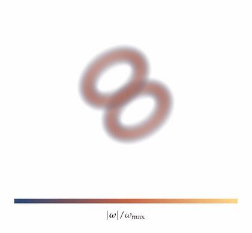

# rustplotlib

Scientific figures with LaTeX typography. Rust renders the geometry; LaTeX
typesets every label, tick and equation. PDF keeps text and curves as vectors.


```rust
use rustplotlib::*;

let mut figure = Figure::new(IntendedUse::ArticleColumn);
let panels = figure.grid(1, 1)?;
figure.panels[panels[0]].axes = Some(Axes::new(
    [0., 10.], [-1., 1.], r"$t\,[\mathrm{s}]$", r"$p'/p_0$",
));
figure.panels[panels[0]].push(Layer::Line(Line::new(points, "#245774")));
figure.save("figure.pdf")?;
```

`ArticleColumn`, `ArticleWide`, `Mobile`, `DesktopHalf`, or custom dimensions.
Defaults use 10–13 pt type, consistent margins and golden-ratio panel geometry.
Panels can also be positioned freely in millimetres. Axes are optional.

- Rectilinear and curvilinear `pcolormesh`; `contour` and `contourf`.
- Shared or independent colorbars; linear, log and signed-asinh scales.
- PDF, PNG, JPEG and SVG. Missing values remain missing.
- Rust/WASM + WebGL2 field and volume renderers, playback and orbit controls.



## Run

Native exports require TeX Live/MacTeX (`latex`, `dvisvgm`, `mathpazo`).

```sh
cargo run --release --example publication
cargo test
```

Browser demo:

```sh
rustup target add wasm32-unknown-unknown
cargo install wasm-bindgen-cli --version 0.2.129 --locked
npm install
npm run build
npm run serve
```

Open `http://127.0.0.1:8791`. The browser uses cached LaTeX SVG glyphs;
it does not need a TeX installation. Example fields are generated by
`examples/web_data.rs`; the vortex rings are analytic demonstration data.

See [the API notes](docs/API.md) for coordinates, normalization and embedding.

[Live gallery](https://jvierine.github.io/rustplotlib/gallery/index.html) · [Examples](gallery/README.md): KHI, HEIMDALL maps, spherical cutaways,
3-D functions and Dimant–Oppenheim density.
