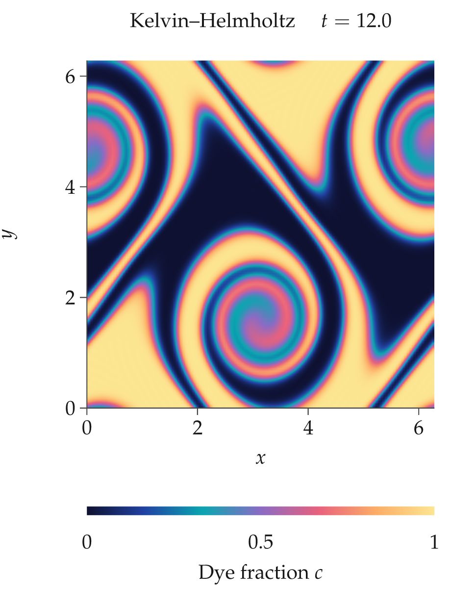
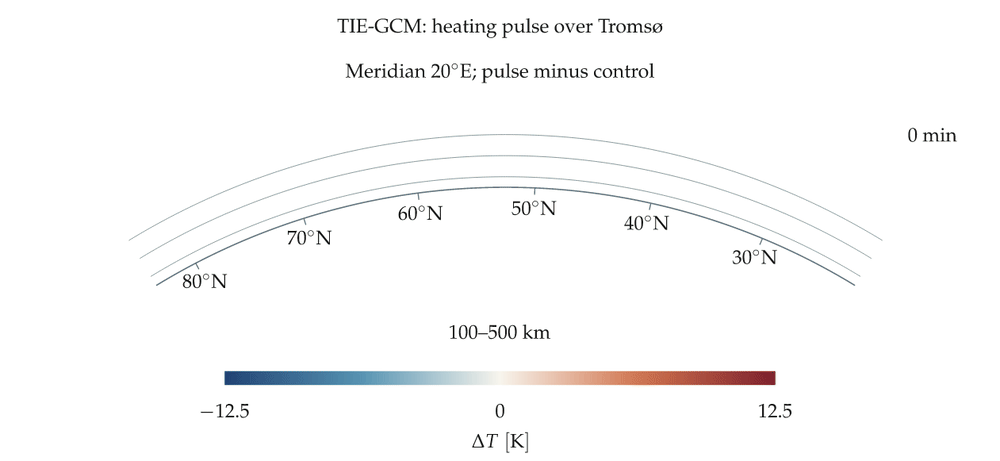
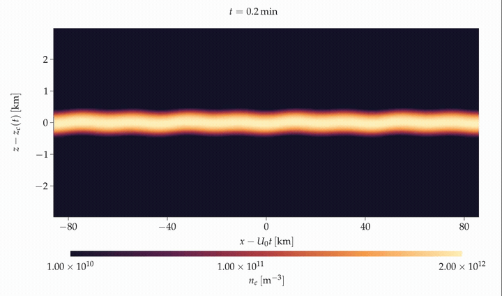
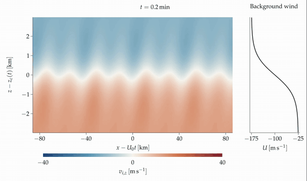

# rustplotlib

[Live gallery](https://jvierine.github.io/rustplotlib/gallery/index.html) · [Examples](gallery/README.md)

Rustplotlib is a plotting library inspired by Matplotlib, implemented in Rust.
Its purpose is clean scientific plotting with LaTeX math, for publication-quality
figures and interactive Rust/WASM + WebGL web pages.

The design priorities are:

- **Scientific publications:** body-sized text at the final article width, checked LaTeX inclusion, restrained layouts, aligned panels, and clear colour bars.
- **LaTeX mathematics:** labels, ticks, symbols, and equations use genuine LaTeX; PDF preserves vector text and curves.
- **Interactive web plots:** Rust/WASM + WebGL views with camera controls, changing data, and animation playback.
- **Animation and extensibility:** render evolving simulations, export movies, and add plotting features without sacrificing scientific clarity.
- **Vibecodability:** a small, familiar API that makes figures easy to create, inspect, and revise from code, including AI-assisted coding.

Native Rust renders publication exports. Rust/WASM + WebGL supports interactive
browser views. LaTeX typesets the notation. The examples demonstrate both output
paths; feature coverage differs between the native and browser APIs.

```rust
use rustplotlib::*;

// The manuscript's linewidth (mm) and normal body font (TeX pt).
let article = ArticleLayout::new(85.0, 10.0)?;
let mut figure = article.figure(1.0, 65.0)?;
let panels = figure.grid(1, 1)?;
figure.panels[panels[0]].axes = Some(Axes::new(
    [0., 10.], [-1., 1.], r"$t\,[\mathrm{s}]$", r"$p'/p_0$",
));
figure.panels[panels[0]].push(Layer::Line(Line::new(points, "#245774")));
figure.save_for_article("figure.pdf", "figures/figure.pdf")?;
```

**Design at the size readers will see.** `article.figure(0.5, height_mm)` halves
the canvas width, not the font. Lay out panels for that smaller canvas. The PDF
and generated `figure.include.tex` bind the final physical width to the article
body size. The inclusion checks the manuscript's `\linewidth` and normal font;
changed manuscript settings require regeneration instead of silently shrinking
labels. Paste the snippet into the figure environment (or input it) without
`\resizebox`, `\scalebox`, or another scaling wrapper. These external transforms
cannot be detected by the Rust library. Article exports trim blank outer margins
by default and include the cropped PDF at its exact physical size, preserving
body-sized labels. `save_fixed_for_article` explicitly retains the full design
canvas. Width overrides and font overrides remain rejected. Generic `IntendedUse`
presets remain available for unbound plots and non-publication output.

For web pages, use `WebLayout::new(container_css_px, body_font_css_px)` and
`save_for_web`. The generated SVG embed uses text-relative `em` sizing, so its
labels follow the surrounding CSS font. A narrow container scrolls instead of
silently shrinking the plot. For responsive designs, render separate layouts
at the target widths; the [web typography example](examples/web_typography.rs)
demonstrates desktop/mobile selection while retaining the same label size.
Web exports also trim blank outer margins by default and update the embed width
without enlarging the labels. Use `save_fixed_for_web` when fixed animation
frames or deliberate whitespace are needed.

## Scientific examples

Native scientific exports, interactive WebGL pages, and simulation animations.
Click a figure to open its PDF, animation, or interactive view.

| Curvilinear mesh | Acoustic–gravity dispersion |
|:--:|:--:|
| [](gallery/curvilinear.pdf) | [](gallery/dispersion.pdf) |
| [PDF](gallery/curvilinear.pdf) · [Source](examples/gallery.rs) | [PDF](gallery/dispersion.pdf) · [Source](examples/gallery.rs) |

| KHI evolution and diagnostics | Dimant–Oppenheim density surface |
|:--:|:--:|
| [](gallery/khi_summary.pdf) | [](gallery/dimant_surface.pdf) |
| [PDF](gallery/khi_summary.pdf) · [Source](examples/khi_summary.rs) | [PDF](gallery/dimant_surface.pdf) · [Source](examples/dimant_oppenheim.rs) |

| Kelvin–Helmholtz instability | Measured HEIMDALL TEC |
|:--:|:--:|
| [](gallery/khi.gif) | [](https://jvierine.github.io/rustplotlib/heimdall.html) |
| [PDF](gallery/khi_t0.pdf) · [Source](examples/khi.rs) | [PDF](gallery/heimdall.pdf) · [Source](web/src/heimdall.ts) |

| GAMERA current paths | SMILE UVI on Earth |
|:--:|:--:|
| [](https://jvierine.github.io/rustplotlib/currents.html) | [](https://jvierine.github.io/rustplotlib/smile.html) |
| [PDF](gallery/currents.pdf) · [Source](examples/scientific_views.rs) | [PDF](gallery/smile.pdf) · [Source](examples/scientific_views.rs) |

| TIE-GCM heating pulse | Damped oscillations at article-column size |
|:--:|:--:|
| [](gallery/tiegcm.pdf) | [](gallery/single_column.pdf) |
| [PDF](gallery/tiegcm.pdf) · [Source](examples/tiegcm.rs) | [PDF](gallery/single_column.pdf) · [Source](examples/publication.rs) |

[](gallery/tiegcm_animation.mp4)

[TIE-GCM animation MP4](gallery/tiegcm_animation.mp4) · [Rust source](examples/tiegcm_animation.rs). All 49 saved five-minute outputs; the four-panel static figure remains above.


| KHI electron-density animation | Ion drift and background wind |
|:--:|:--:|
| [](gallery/syisr_khi_density.mp4) | [](gallery/syisr_khi_ion_up.mp4) |
| [PDF](gallery/syisr_khi_density.pdf) · [Source](examples/syisr_khi.rs) | [PDF](gallery/syisr_khi_ion_up.pdf) · [Source](examples/syisr_khi.rs) |

The KHI cases are simulated demonstrations, not observational fits.
[Browse all examples](gallery/README.md).

`ArticleColumn`, `ArticleWide`, `Mobile`, `DesktopHalf`, or custom dimensions.
Defaults use 10–13 pt type, consistent margins and golden-ratio panel geometry.
Panels can also be positioned freely in millimetres. Axes are optional.
External colorbars automatically reserve measured LaTeX axis-label space plus
a `0.6 em` gap. Horizontal layouts grow vertically when needed. Use
`Figure::layout_colorbars()` to obtain resolved coordinates for web overlays;
`auto_colorbar_layout = false` opts into exact manual placement.

- Rectilinear and curvilinear `pcolormesh`; `contour` and `contourf`.
- Shared or independent colorbars; linear, log and signed-asinh scales.
- Seamless arbitrary-cell `PolygonMesh` rendering, with missing values preserved.
- Exact seismic/inferno palettes, custom axis tick labels and routed panel connectors.
- PDF, PNG, JPEG and SVG. Missing values remain missing.
- Rust/WASM + WebGL2 field and volume renderers, playback and orbit controls.

## Run

Native exports require TeX Live/MacTeX (`latex`, `dvisvgm`, `mathpazo`).

```sh
cargo run --release --example publication
cargo test
```

Browser demo:

```sh
rustup target add wasm32-unknown-unknown
cargo install wasm-bindgen-cli --version 0.2.129 --locked
npm install
npm run build
npm run serve
```

Open `http://127.0.0.1:8791`. The browser uses cached LaTeX SVG glyphs;
it does not need a TeX installation. Example fields are generated by
`examples/web_data.rs`; the vortex rings are analytic demonstration data.

See [the API notes](docs/API.md) for coordinates, normalization and embedding.

[Live gallery](https://jvierine.github.io/rustplotlib/gallery/index.html) · [Examples](gallery/README.md): KHI, HEIMDALL maps, spherical cutaways,
3-D functions and Dimant–Oppenheim density.

Exports crop to visible content by default with 1 mm padding (`Figure::tight_export`, `Figure::export_padding_mm`). Article and web export helpers preserve physical/CSS typography when trimming. For deliberate whitespace, use `save_fixed_for_article` or `save_fixed_for_web`; unbound figures can set `tight_export=false`. Surface geometry fills its panel by default (`Surface::fit_to_view`); disable it to retain the unit-cube camera framing. HEIMDALL Scientific PNG exports the WebGL figure and labelled colour bar without page UI.

### HDF5 simulation rendering

The optional KHI example reads HDF5 fields and renders them with Rustplotlib;
the fluid solver is separate. The included compact fixture contains actual
model checkpoints at 0, 60 and 120 minutes. Complete MP4 examples retain all
721 checkpoints. No replacement background or packet mask is applied.

```sh
# Install an HDF5 development library (e.g. libhdf5-dev on Ubuntu).
cargo run --release --features hdf5-examples --example syisr_khi
```

[Input schema and animation instructions](examples/syisr_khi.md).

Secondary horizontal axes use `Axes::secondary_x` with
`SecondaryAxis::new(label, ticks, to_primary)`. The inverse coordinate mapping
positions ticks on the primary scale, including nonlinear reciprocal mappings.
See [the secondary-axis example](examples/secondary_axis.rs).

### Observation/model composite

`examples/norden.rs` reads external archived HDF5 observations and model fields
from a NORDEN proposal checkout. It combines orthographic globes, sparse TEC
polygons, vector coastlines, orbital-decay time series and a linked radar inset.
The input data are not bundled with this library. This example also requires
Ghostscript (`gs`), which normalizes shared PDF resources for XeLaTeX inclusion
without rasterizing vector geometry or downsampling images. Labels use 9 pt LaTeX at the
intended 170 mm publication width; the source fields and their masks are retained.

```sh
HDF5_DIR=/opt/anaconda3 cargo build --release --features hdf5-examples --example norden
DYLD_LIBRARY_PATH=/opt/anaconda3/lib target/release/examples/norden /path/to/norden
```

These paths use a local conda HDF5 installation on macOS; on other systems use
the installed HDF5 development library. The example writes PDF, PNG, SVG and
an HDF5 record of plotted samples. `Axes::xticklabels` / `yticklabels` change
only displayed text, not coordinates. `Figure::connectors` links data positions
in two panels through optional millimetre waypoints.

For data-anchored text, `Figure::annotate` measures LaTeX glyphs and chooses a
position clear of visible geometry and existing labels. For animations with
fixed labels, call `Figure::check_annotations(&panel, &labels)` on every frame
after updating the data or camera. It rejects intersections with lines,
meshes, projected surfaces, and other supplied annotations, including rotated
text and opaque backgrounds. Check intermediate frames as well as endpoints;
no placement algorithm can certify a moving scene from a single frame.
