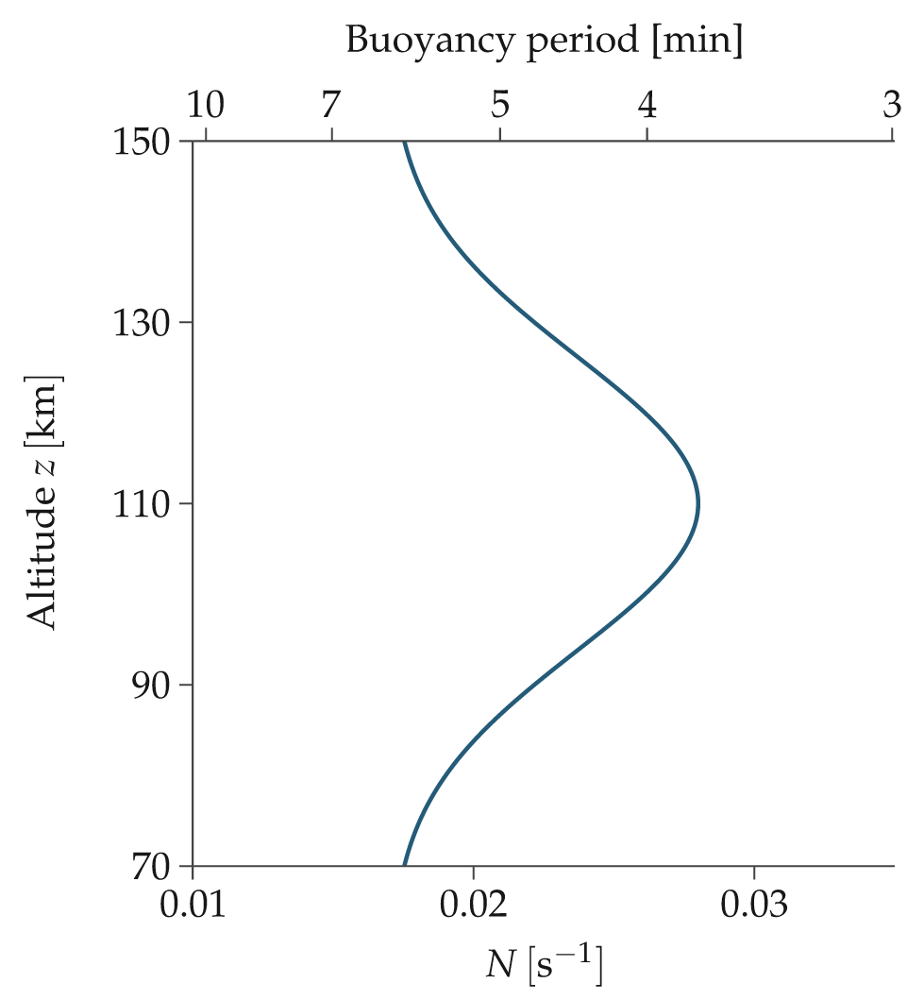
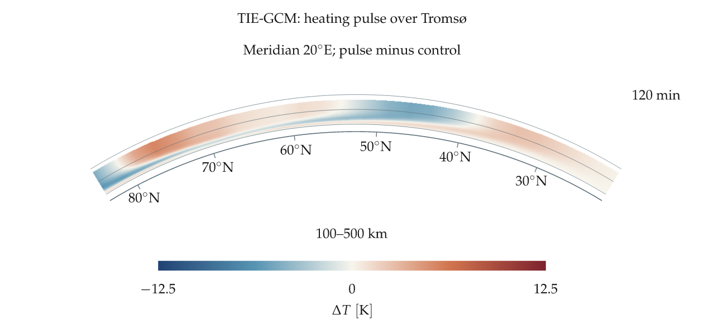
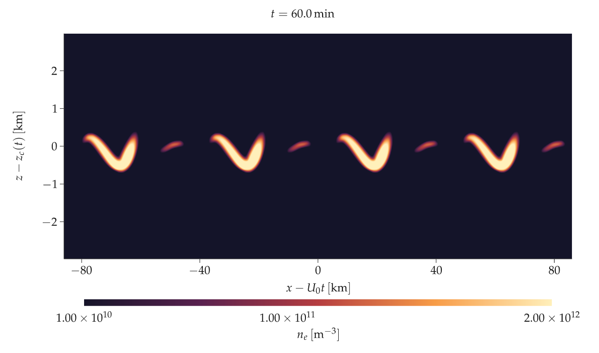
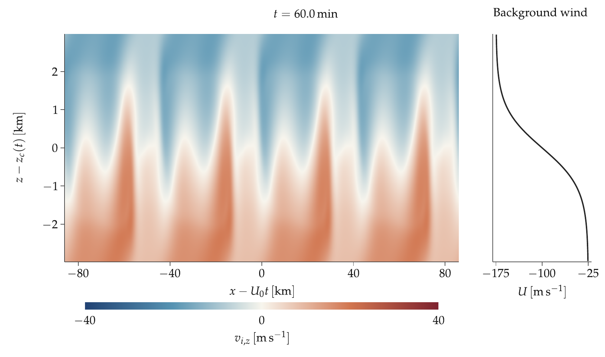

# Gallery

Generate the additional examples with `cargo run --release --example gallery`.
Native figures are exported at 300 dpi and their intended physical size. HEIMDALL uses measured VTEC; the atmospheric cutaways use analytic fields.

## Field primitives

pcolormesh, contourf, contour and independent color scales.

[PDF](fields.pdf) · [PNG](fields.png) · [SVG](fields.svg) · [Source](../examples/publication.rs)

## Article column

85 mm wide with 10 pt LaTeX type.

[PDF](single_column.pdf) · [PNG](single_column.png) · [SVG](single_column.svg) · [Source](../examples/publication.rs)

## Keogram with gaps

Shared signed-asinh scale, masked samples and a propagation guide.

[PDF](keogram.pdf) · [PNG](keogram.png) · [SVG](keogram.svg) · [Source](../examples/gallery.rs)

## Curvilinear mesh

Physical quadrilateral corners, with equal x/y scale.

[PDF](curvilinear.pdf) · [PNG](curvilinear.png) · [SVG](curvilinear.svg) · [Source](../examples/gallery.rs)

## Mathematical annotations

Acoustic and gravity branches of an analytic dispersion relation.

[PDF](dispersion.pdf) · [PNG](dispersion.png) · [SVG](dispersion.svg) · [Source](../examples/gallery.rs)

## Color normalization

Linear, signed-asinh and logarithmic magnitude views.

[PDF](normalizations.pdf) · [PNG](normalizations.png) · [SVG](normalizations.svg) · [Source](../examples/gallery.rs)

## Mobile preset

13 pt type at mobile-page width.

[PDF](mobile.pdf) · [PNG](mobile.png) · [SVG](mobile.svg) · [Source](../examples/gallery.rs)

## Desktop half-window

12 pt type for a wider on-screen figure.

[PDF](desktop.pdf) · [PNG](desktop.png) · [SVG](desktop.svg) · [Source](../examples/gallery.rs)

## Reciprocal secondary axis

An analytic buoyancy profile with height vertically and period on the top axis; not an MSIS atmosphere. [Source](../examples/secondary_axis.rs)

## Small multiples and diagnostics

KHI evolution with directly labelled energy and enstrophy. [Source](../examples/khi_summary.rs)

## Functions of two variables

Depth-tested, shaded 3-D surfaces. [Source](../examples/surfaces.rs)

## Dimant--Oppenheim density

Logarithmic density cross-section and directly labelled profiles. [Source](../examples/dimant_oppenheim.rs)

## Meteor density surface

Log-height surface of the same density function. [Source](../examples/dimant_oppenheim.rs)

## Kelvin--Helmholtz instability

Periodic viscous Navier--Stokes with passive dye. [Source](../examples/khi.rs)

## HEIMDALL cartography

Measured VTEC; shared HEIMDALL WebGL2 renderer, globe and flat-map views. [Source](../web/src/heimdall.ts)

## GAMERA current paths

Traced current-density paths with a scientific PNG/PDF export. [Source](../examples/scientific_views.rs)

## SMILE aurora on Earth

Projected UVI above a textured Earth; rotate the interactive globe. [Source](../examples/scientific_views.rs)

## Curved atmospheric sections

Completed TIE-GCM heating-pulse experiment, compared with its control at common geometric heights. [Source](../examples/tiegcm.rs)

## Mixing atlas

KHI snapshots, aligned profiles, small multiples and inline diagnostics. [Source](../examples/visual_essays.rs)

## Meteor wake anatomy

Density, marginal profile and cumulative footprint of the Dimant–Oppenheim function. [Source](../examples/visual_essays.rs)

## One wave, twelve clocks

Stacked analytic receiver traces with a shared arrival guide. [Source](../examples/visual_essays.rs)

## Spherical cutaways

Interactive temperature, density and wind demonstration fields. [Source](../examples/atmosphere.rs)

## TIE-GCM heating-pulse evolution

One curved meridian panel through all 49 saved outputs (0–240 minutes, five-minute cadence), fixed colour scale and no temporal interpolation. The static four-panel figure is retained separately. [MP4](tiegcm_animation.mp4) · [PDF](tiegcm_animation.pdf) · [Rust source](../examples/tiegcm_animation.rs)

## KHI electron-density evolution

Two-hour Ri=0.08 model, following the mean zonal drift; no field clipping. [MP4](syisr_khi_density.mp4) · [PDF](syisr_khi_density.pdf) · [Rust source](../examples/syisr_khi.rs)

## Ion drift and background shear

The 60-minute Ri=0.08 snapshot: upward magnetic ion drift with an equal-height background-wind profile, LaTeX labels and a signed color scale. Animation below. Simulated, not an observed fit. [MP4](syisr_khi_ion_up.mp4) · [PDF](syisr_khi_ion_up.pdf) · [Rust source](../examples/syisr_khi.rs)
